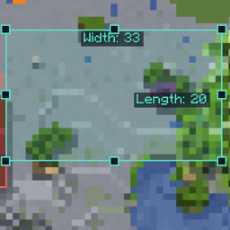

# Exact Selection for Xaero's map

**English** | [Русский](README.ru.md)

A client-side Fabric addon for Minecraft **1.21.11** that adds precise area selection, saved zones, groups, and PNG map exports to Xaero’s World Map.

Create rectangles or custom polygons, edit their boundaries, and display your saved areas on both the world map and minimap.

**This is an unofficial addon, not affiliated with or endorsed by Xaero.**

## Features

- **Precise selection:** select rectangles using the map or enter exact coordinates.
- **Custom polygons:** build areas vertex by vertex, with filled interiors and editable outlines.
- **Saved areas and groups:** name, organize, color, and hide your zones.
- **Persistent overlays:** control area visibility on the world map and minimap separately.
- **Measurements:** view dimensions, area, and perimeter; a ruler measures a line through any points and saves it as a route.
- **Quick copying:** copy each rectangle corner separately as `X Z`, along with other measurements; area and perimeter are rounded down, up, or not at all.
- **PNG export:** save a selection or a saved area as an image that looks like the in-game map.
- **Waypoint tools:** manage Xaero waypoints inside the selection or across the whole set.
- **Settings in Mod Menu:** autosave and copy rounding, also available from the Areas window.

## Installation and compatibility

- Minecraft **1.21.11**, Java **21**, Fabric Loader **0.17.3+**, and Fabric API **0.139.4+** for this Minecraft version.
- Xaero’s World Map **1.40.4 – 1.47.x** is required, together with the XaeroLib version that World Map asks for.
- Xaero’s Minimap **25.3.5 or newer** is optional. It enables minimap overlays and waypoint creation/editing/deletion. Every Minimap release for 1.21.11 up to 26.6.2 has been checked. If a future Minimap changes the parts the addon uses, only the minimap overlay and waypoint features turn off; the game still starts.
- Put `exact-selection-for-xaeros-map-1.3.3+1.21.11.jar` in your instance’s `mods` folder and enable the selection tool on the fullscreen map. Install it on the client only.

The addon uses Xaero internals. Other World Map or Minecraft versions need separate compatibility work.

## Selection and editing

| Action | Result |
|---|---|
| Left click, then left click | Set the two corners of a rectangle |
| Drag a handle | Resize the rectangle |
| Drag inside the finished selection (or Shift + drag, also from a handle) | Move the whole rectangle or polygon, also with the Polygon tool on; a click inside without moving keeps it, or with the Polygon tool starts a new contour there |
| Right click inside the selection | A menu styled like Xaero's own with quick actions: Size (not for polygons), Move, Center and Clear selection; plus Save… for a new selection, or Color…, Fill and Delete zone (after confirmation) for the territory being edited |
| Right click a saved area | The same menu for that area, with its name, group and size on top (click one to copy it): Edit territory, Color…, Fill, Hide and Delete zone (a route has Color…, Hide and Delete zone); of overlapping areas it takes the smallest |
| Right mouse drag | Pan the map |
| Scroll outside the panel | Zoom around the cursor |
| Coordinates / Size / Move | Enter exact coordinates, dimensions or offsets |
| Ctrl/Cmd+Z, Ctrl+Y or Cmd+Shift+Z | Undo / redo |
| Esc | Cancel a gesture/dialog/draft, clear the selection, then leave the tool; undo brings a cancelled contour back |
| Map key (M by default) | Close the map. The tool, selection, contour and undo history are there when it opens again in the same world |
| O, R, J, N | Polygon, ruler, Areas, blocks or chunks, while the tool is on; change them in Options → Controls → Key Binds under Exact Selection for Xaero's map |

The compact panel is enabled by default and shows dimensions, area, copy buttons, undo, Polygon and Areas; Esc or right click → Clear selection clears the selection. The double-chevron icon in the header expands it for coordinate input, Apply, Save, Clear, waypoint management and PNG export; Size, Move and Center are in the selection's right-click menu. The expanded panel scrolls on small screens. Undo and redo are small arrow buttons with action tooltips.

Blocks are the default unit. Both endpoint blocks are included: `(0, 0)` to `(15, 15)` is **16 × 16 = 256 blocks²**. Chunk mode snaps rectangle edges to the 16-block grid, including negative coordinates. Coordinate input stays exact, and a saved area being edited keeps its shape until you change it. Width is the X extent and length is the Z extent. Polygon dimensions describe its bounding box; area and perimeter follow its actual shape.

Area and perimeter are copied rounded to whole blocks: **Rounding: down** (the default), **up** or **none** (keeps their fractions) in the gear settings of the Areas window or in Mod Menu. Small copy-icon buttons sit immediately after the coordinates, width, length, area and perimeter values in both panel modes. Each coordinate row has its own button: A and B are copied separately as `X Z`, with a space between the numbers. In the Areas window a saved rectangle lists all four corners by direction — NW, NE, SW, SE (north is -Z, west is -X) — each with its own copy button; polygon vertex copying keeps every vertex, with space-separated coordinate pairs. The Center dialog copies the bounding-box center or creates a waypoint there at the player’s current Y level. A 3×6 rectangle has a perimeter of 18 blocks. Non-integer lengths are displayed to two decimal places.

New rectangle corners, contour vertices, dragged edges and vertices, and moved shapes stick to saved areas and routes within 8 GUI pixels of the pointer, vertices first, so neighbours share a border without a gap or an overlap. A rectangle corner takes the block on the pointer's side of the border. Alt turns this off, chunk mode keeps its own grid, and hidden areas and the area being edited attract nothing.

### Ruler

The ruler button (in the panel header, beside the expand icon) measures a line through points, which snap to block corners like contour vertices: click point A, then point B, or drag from A to B. Ctrl/Cmd + click goes on with another point and Backspace takes the last one back. Shift keeps a point on the previous one's row or column. The line and its length are drawn on the map; the panel shows the length with a copy button (rounded like area and perimeter), ΔX, ΔZ and the distance along the axes from A to the end, and in the Overworld or the Nether the same length in the other dimension (÷8 or ×8). The next plain click starts a new measurement. Esc clears it, then turns the ruler off.

**Save** in the panel header keeps the line as a route for roads and tunnels: an entry of the Areas window with a name, color and group, drawn as an open line on the world map, minimap and PNG exports, which you can hide, delete and exchange like an area. A route has no fill and its shape cannot be edited. The ruler leaves the selection unchanged and turns the Polygon tool off, and the other way round. While it is on, the panel is compact; turning it off brings the previous panel back, and the expand icon turns it off and expands the panel.

### Polygons

Enable the Polygon tool, click vertices and finish by clicking the first vertex or pressing Enter. Backspace removes the last draft vertex. Shift aligns new vertices horizontally or vertically. Simple, non-intersecting polygons with 3–256 vertices are supported and have a fill.

- Drag a vertex to move it, in both drafts and completed polygons (Ctrl/Cmd + drag works too). A click on a vertex without movement keeps it in place; in a draft a click on the first vertex still closes the contour.
- While drawing, and on a contour just closed with the Polygon tool still on, a click on a side does nothing and shows these controls; a double click there adds a vertex on that side. Ctrl/Cmd + click away from the vertices adds a vertex as a plain click does.
- Double click an edge to insert a vertex on that edge.
- Ctrl/Cmd + double click a vertex to delete it, in both drafts and completed polygons. A completed shape must keep at least three vertices.
- Ctrl/Cmd + drag a rectangle corner to turn it into an editable polygon. A click without movement keeps the rectangle.
- Double click an edge of a saved rectangle opened for editing to insert a vertex and turn it into a polygon.

Invalid intersecting or duplicate-vertex edits are rejected. Polygon geometry and draft changes support undo/redo. Polygon width/length labels remain in the panel rather than covering the map.

## Saved areas and groups

**Save** sits in the header next to the expand icon in the compact panel, and above Apply beside the coordinate fields in the expanded one; for a territory being edited it saves its shape. Enter a name, use the Group button to cycle through existing groups (the default is no group), set the fill with the Fill button (0, 25, 50, 75 or 100%) and pick one of 24 colors right below or type your own `#RRGGBB` under the palette, with a preview beside it. Clicking the preview opens a full color picker: a saturation and brightness square with a hue bar beside it; Apply hands the color back. Color and fill are remembered for the next area. After saving, the selection is cleared so the next area can be drawn; the first undo brings the selection back, the second removes the saved area. Saving a new area does not enter editing mode.

To change an existing area's shape, select it in **Areas** and choose **Edit territory** (it then reads **Territory being edited**). Change the shape and choose **Save** on the selection panel. While editing, the stored shape is drawn faded behind the live bounds. This association survives moves, coordinate edits, redraws and undo/redo. If the area is off screen, the map moves to it. Clear the selection or turn the tool off to end editing. **Save selection…** in the Areas window can save a separate copy while editing.

Areas opens the Areas window, and Manage groups… there opens the separate Groups window. The Areas window opens with nothing checked. Click a row to check one area, Ctrl/Cmd+click (or its checkbox) to add or remove one, Shift+click to check the range from the last clicked row, Ctrl/Cmd+Shift+click to add that range. The Search by name field above the list keeps areas whose name contains the text, ignoring case; All checks only those, and the search clears whenever the window opens. The order button above the list sorts by date added (oldest first), name, group or visibility. The target button beside the name, or a double click on a row, closes the window and shows the area on the map, zoomed to fit.

**Export** writes the checked areas — or every area of the world when none is checked — to a JSON exchange file in `config/xaero-exact-selection/exports/`; **Export group** in the Groups window writes one group. The folder button beside **Import…** and beside **Export group** opens that folder. **Import…** lists the files in that folder (**Open folder** to drop in files from others) and adds the clicked file's areas to the current world as one undoable step: groups are matched by name or created, and areas identical to existing ones are skipped. **Areas in selection: N** in the expanded panel opens the list with the saved areas that overlap the current selection checked (areas that only touch its edge are not included). **Areas** is available in both panel modes.

- Name, **Group**, **Color…** (24 colors, custom `#RRGGBB` / `#RGB`, or the full picker from the preview beside the field) and fill are edited in the form and marked with `*` until **Save** (below Edit territory and Export map) writes them to every checked area in one undoable step. Checking other areas or closing the window discards unsaved changes.
- The gear button at the bottom opens its settings in the same window: a main switch and separate switches for name, group, color, fill and territory shape. Enabled changes are written immediately and Save disappears unless a change outside autosave is waiting; a "● Autosave" indicator shows that it is on. With territory-shape autosave, each edit of a loaded area is written together with the selection change and undone in one step. The settings are shared by all worlds and are also available from Mod Menu (the mod's settings button), together with copy rounding.
- The **Selected** section at the bottom of the column, apart from the area's own controls, shows or hides and deletes the checked areas. Small copy icons follow the name and each coordinate or metric value of a single checked area. Rectangles show width and length; polygons show their vertex count. Both show area and perimeter.
- Create, rename, hide or delete groups in the Groups window. Each group row shows its number of areas and their total area; below the buttons are the totals for all areas and for areas without a group. Overlapping areas are counted once each.
- Individual visibility and group visibility are independent. A hidden group suppresses its areas without changing their individual settings.
- Delete checked areas after confirmation; deletion supports undo.
- World map and Minimap switches independently control persistent overlays when the selection tool is off; while it is on, saved areas are always drawn on the world map. The first area saved in a world switches World map on. Names hides area names on the world map while the areas stay drawn. All three are saved per world and can be undone.

Settings and areas are stored per world/server, dimension and subworld in `config/xaero-exact-selection/`. The technical mod ID `xaero_exact_selection` and the legacy storage directory are retained for compatibility with existing installations. Schema 3 gains a `polyline` geometry for routes, which older versions of the mod cannot read. A file names its world in its `context` field. Writes use a temporary file and atomic replacement where supported, and keep the previous version beside the file as `.bak`. An unreadable existing file is kept and is not overwritten with empty data; **Restore the previous version** in the Areas window puts the `.bak` back and keeps the damaged file as `.broken`. One dimension holds at most 1000 areas and 200 groups.

## Xaero waypoints

**Waypoints: N** / **All waypoints…** opens management of ordinary saved waypoints in the current Xaero set. Search by name, filter visibility/color, check rows (a scrollbar appears when the list is longer than the window), delete waypoints, rename them together or choose one of Xaero’s 16 waypoint colors. Editing names preserves symbols and initials.

With a completed selection, the window initially shows and checks the points inside it. Without a selection, it opens the entire set with **nothing checked**. The scope button switches between the selection and the whole set. Actions affect only checked rows matching the filters, and the window stays open after each action.

Before each write, the addon checks that the points and set still match the displayed snapshot. Stale actions refresh the list instead of changing unexpected points. Save failures restore in-memory data and attempt to persist the rollback. Actions support undo/redo. Temporary, server, death and destination waypoints are excluded.

## PNG export

Expand the selection panel and choose **Export selection as PNG…**, or **Export map…** for one saved area in the Areas window. Saving the working selection first is unnecessary. The export window shows:

- **Folder**: Xaero's own export folder (normally `map exports/` in the game directory) or any absolute path; **Choose…** opens the system folder picker. **Default folder** clears the field. An empty, unfocused field shows the default path in grey as a placeholder and still exports there. The full path of the file to be written is shown below.
- **Areas: on/off** includes or hides saved areas in the exported image. When off, fills, outlines and area names are omitted; the selected export territory and visibility on the in-game maps stay unchanged. The choice is remembered, and area labels become available again when areas are enabled.
- **Time: day / night**: night uses Xaero's own night export, with the dark sky and block light.
- **Scale**: 1, 2, 4 or 8 image pixels per block; the map is enlarged without blurring and the resulting image size is shown.
- **Labels: on / off**.
- **This area's fill: on/off** — only when exporting a saved area (from the Areas window or loaded for editing): leaves out that area's own fill so the map under it is not tinted. Its outline and name and other areas' fills stay. The choice is remembered.

The image looks like the in-game World Map: translucent area fills with thin outlines, and names in the area's color with Minecraft's pixel font, drop shadow and dark backing, drawn above all fills. As in game, an area is named once it is large enough for its label. Pixels outside a polygon are transparent. The choices are remembered for all worlds.

Native map preparation runs on the client thread; enlarging, drawing and PNG encoding run in the background. **Show file in folder** reveals the result. Map data must be loaded. Export is limited to 8,000,000 map blocks and 16,000,000 image pixels; above that the window disables Export and asks for a smaller scale.

## Building

```sh
./gradlew build
```

The default build resolves Xaero dependencies from its Maven repository. The exact dependency coordinates above were verified with a successful Gradle build. GitHub Actions builds on Temurin Java 21, checks localization, and uploads `build/libs/*.jar`. To use local Xaero JARs:

```sh
./gradlew -PxaeroDeps=build/xaero-deps build
```

To check the language files:

```sh
python3 tools/check_localization.py
```

`tools/IntegrationSmokeCheck.java` initializes Fabric against the real Minecraft/Xaero dependencies in a separate temporary game directory. It verifies mixin application and the remapped GUI bridge without launching a game window. It requires the Fabric runtime classpath, the intermediary Minecraft JAR, Fabric API and the addon/Xaero JARs in the temporary `mods` directory.

`tools/XaeroApiCheck.java` lists every Xaero class, method and field the built JAR uses, including Mixin targets, shadows and accessors, that a given set of Xaero JARs lacks: `java -cp <asm, asm-tree>:<classes> XaeroApiCheck <addon.jar> <xaero jars…>`. It prints `OK` when nothing is missing.

Tests cover geometry, saved-area persistence, waypoint write rollback, editing/undo, localization, and UI widget layouts at 320×240, 480×270 and 960×540. They do not establish visual correctness in a running Minecraft client.

## License

The addon code is licensed under [MIT](LICENSE). Xaero mods remain separate dependencies and are not bundled. See [CHANGELOG.md](CHANGELOG.md) for release notes.
