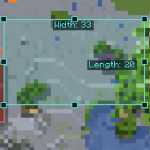

# Exact Selection for Xaero's map

[English](README.md) | **Русский**

Клиентский Fabric-аддон для Minecraft **1.21.11**: точное выделение областей, сохранённые зоны, группы и экспорт карты в PNG для Xaero’s World Map.

Создавайте прямоугольники и произвольные многоугольники, редактируйте их границы и показывайте сохранённые зоны на карте мира и миникарте.

**Это неофициальный аддон, он не связан с Xaero и не одобрен им.**

## Возможности

- **Точное выделение:** прямоугольники мышью на карте или вводом точных координат.
- **Многоугольники:** зона строится по вершинам, с заливкой и редактируемым контуром.
- **Сохранённые зоны и группы:** названия, группы, цвета и скрытие зон.
- **Постоянные оверлеи:** видимость зон на карте мира и на миникарте настраивается отдельно.
- **Измерения:** размеры, площадь и периметр; линейка меряет линию через любые точки и сохраняет её как маршрут.
- **Быстрое копирование:** каждый угол прямоугольника отдельно как `X Z` и остальные измерения; площадь и периметр округляются вниз, вверх или не округляются.
- **Экспорт в PNG:** выделение или сохранённая зона сохраняется картинкой, как на карте в игре.
- **Точки Xaero:** управление точками внутри выделения или во всём наборе.
- **Настройки в Mod Menu:** автосохранение и округление при копировании, они же доступны в окне областей.

## Установка

1. Используйте Minecraft 1.21.11, Java 21 и Fabric Loader **0.17.3 или новее**.
2. Установите Fabric API для Minecraft 1.21.11 (**0.139.4 или новее**), Xaero’s World Map **от 1.40.4 до 1.47.x** и XaeroLib той версии, которую требует World Map.
3. Для создания и удаления точек и показа зон на миникарте нужна Xaero’s Minimap **25.3.5 или новее**. Проверены все версии для 1.21.11 до 26.6.2. Если будущая версия миникарты изменит то, чем пользуется аддон, отключатся только миникарта и вейпоинты — игра всё равно запустится.
4. Поместите `exact-selection-for-xaeros-map-1.3.3+1.21.11.jar` в `mods`, откройте полноэкранную карту и включите режим.

Версии Xaero закреплены, потому что аддон использует внутренние поля World Map. Для других версий требуется отдельная проверка совместимости. Аддон работает только на клиенте; серверная установка не нужна.

Панель точного выделения открывается в компактном виде: размеры, площадь, копирование, отмена, «Контур» и «Области»; выделение сбрасывается Esc или ПКМ → «Снять выделение». Кнопка с двойной стрелкой вниз в шапке разворачивает панель (поля координат, «Применить», «Сохранить», «Сбросить» и остальные действия), со стрелкой вверх — сворачивает. Переключение сохраняет выделение и незавершённый ввод. На небольшом экране расширенная панель прокручивается колесом мыши внутри панели; за её пределами колесо меняет масштаб карты.

## Новое в 1.3

Кнопка «Сохранить» в компактной панели находится в шапке рядом с кнопкой разворота, в развёрнутой — над «Применить» справа от полей координат; при редактировании зоны она сохраняет её форму. В окне имени можно выбрать группу кнопкой «Группа: …» (каждое нажатие переключает её, по умолчанию — без группы), прозрачность кнопкой «Заливка: …» (0, 25, 50, 75 или 100%) и сразу под ними один из 24 цветов или ввести свой #RRGGBB в поле «Свой цвет» под палитрой — рядом показан образец. Нажатие на образец открывает полноценную палитру: квадрат насыщенности и яркости, полоса оттенка справа, «Применить» возвращает выбранный цвет. Цвет и заливка запоминаются для следующей области, в том числе после перезапуска игры. После сохранения выделение сбрасывается, чтобы можно было сразу рисовать следующую зону: первая отмена возвращает рамку, вторая — удаляет сохранённую область. Быстрое сохранение не включает редактирование новой зоны.

Чтобы изменить форму существующей зоны, выберите её в окне областей и нажмите «Редактировать территорию» (кнопка станет «Территория редактируется»). После изменения формы нажмите «Сохранить» прямо на панели. Пока зона редактируется, её сохранённая форма рисуется приглушённо под яркими новыми границами. Связь с зоной сохраняется при перемещении, правке координат и перерисовке выделения, а также переносится историей отмены. «Сбросить», Esc со сбросом или выключение инструмента завершают редактирование. Если зона за пределами экрана, карта переместится к ней. Через «Сохранить выделение…» в окне областей можно сохранить отдельную копию текущей формы.

В развёрнутой панели рядом с «Области» есть «Области в рамке: N»: она открывает список, где отмечены сохранённые зоны, пересекающиеся с текущим выделением (зоны, которые только касаются его края, не считаются). «Вейпоинты: N» / «Все вейпоинты…» открывает управление вейпоинтами Xaero. Если периметр помещается в одну строку с площадью, он показывается рядом с ней, и панель становится на строку короче. Кнопки отмены и повтора стали стрелками с подсказками. Маленькие иконки копирования стоят сразу после координат, ширины, длины, площади и периметра. У каждой строки координат A и B есть своя кнопка копирования, в том числе рядом с полями развёрнутой панели. Отдельный блок «Скопировать» убран, обе панели стали на 30 пикселей короче. Для полигонов периметр считается по длинам рёбер; для прямоугольника 3×6 он равен 18 блокам.

## Выделение и геометрия

| Действие | Результат |
|---|---|
| ЛКМ по карте | Первый угол, затем второй; следующий клик начинает новую рамку |
| Перетаскивание маркера или стороны рамки | Изменить соответствующий угол или границу |
| Перетаскивание внутри готовой рамки (или Shift + перетаскивание, в том числе с маркера) | Переместить рамку или полигон целиком, в том числе при включённом «Контуре»; клик внутри без движения ничего не меняет, а с «Контуром» ставит первую вершину нового контура |
| ПКМ внутри выделения | Меню в стиле меню Xaero с быстрыми действиями: «Размеры» (не для полигона), «Сдвиг», «Центр» и «Снять выделение»; для нового выделения ещё «Сохранить…», для редактируемой зоны — «Цвет…», «Заливка» и «Удалить область» (с подтверждением) |
| ПКМ по сохранённой зоне | То же меню для этой зоны, сверху её название, группа и размер (клик копирует значение): «Редактировать территорию», «Цвет…», «Заливка», «Поднять выше», «Опустить ниже», «Скрыть» и «Удалить область» (у маршрута — «Цвет…», «Поднять выше», «Опустить ниже», «Скрыть» и «Удалить область»); из пересекающихся берётся самая маленькая |
| ПКМ с перетаскиванием | Переместить карту |
| Колесо вне панели | Масштабировать карту вокруг курсора |
| Поля X/Z и «Применить» справа от них | Ввести точные целые координаты блоков |
| «Размеры» (ПКМ по выделению) | Задать ширину и длину от левого нижнего угла или центра |
| «Сдвиг» (ПКМ по выделению) | Переместить выделение по X/Z в блоках или чанках |
| «Центр» (ПКМ по выделению) | Скопировать координаты центра или создать в нём точку Xaero |
| «Назад» / «Повторить» или Ctrl+Z / Ctrl+Y | Отменить или повторить действие |
| Esc | Отменить текущий ввод или диалог; затем сбросить рамку; затем выйти из режима; отмена возвращает сброшенный контур |
| Клавиша карты (по умолчанию M) | Закрыть карту. Режим, выделение, контур и история отмены останутся при следующем открытии в том же мире |
| O, R, J, N | «Контур», линейка, «Области», блоки или чанки, пока режим включён; меняются в «Настройки → Управление → Клавиши» в разделе Exact Selection for Xaero's map |

Кнопка полигонального режима переключает построение контура: ЛКМ добавляет вершину, Enter или ЛКМ рядом с первой вершиной замыкает его, Backspace удаляет последнюю вершину, Esc отменяет черновик (отмена Ctrl/Cmd+Z его возвращает). При перетаскивании вершины Shift выравнивает её по соседней. Допустимы простые контуры из 3–256 вершин; самопересекающиеся и вырожденные контуры не принимаются. Двойной ЛКМ по стороне готового полигона вставляет новую вершину на самой стороне (в ближайшую к курсору точку), в том числе на замыкающей стороне; форма контура при этом не меняется, а сдвинуть новую вершину можно перетаскиванием. Shift при построении выравнивает новую точку по горизонтали или вертикали относительно предыдущей вершины. Предпросмотр следует той же привязке. Вставка отменяется и повторяется одним действием. Загруженный полигон открывается для редактирования: обычные клики не превращают его в прямоугольник; для нового контура включите инструмент «Контур». Прямоугольные поля координат для полигона доступны только для чтения. Вершины незамкнутого контура и готового полигона перетаскиваются зажатой ЛКМ (с Ctrl/Cmd тоже); клик по вершине без движения её не сдвигает, а клик по первой вершине черновика по-прежнему замыкает контур. При построении и на только что замкнутом контуре (инструмент «Контур» ещё включён) клик по стороне ничего не делает и показывает подсказку, двойной ЛКМ по ней добавляет вершину на эту сторону; Ctrl/Cmd+клик вне вершин добавляет вершину, как обычный клик. Каждое перемещение отменяется одним действием. Недопустимое перемещение с пересечением сторон или совпадением вершин отклоняется; Esc во время перетаскивания возвращает исходную позицию. Ctrl/Cmd+Z и Ctrl/Cmd+Y отменяют и повторяют также добавление и удаление вершин черновика; Cmd+Shift+Z тоже повторяет действие. После замыкания область имеет заливку, площадь, сохраняется, включается в группы и экспортируется как другие области. Длина и ширина полигона отображаются только в меню, без подписей поверх карты. Названия сохранённых областей рисуются поверх всех заливок и текущего выделения, в том числе сразу после сохранения; сбрасывать выделение для чтения названия не нужно. Как и у прямоугольников, название полигона появляется, когда его видимая часть на экране шире 50 и выше 14 точек интерфейса. Контур, заливка и маркеры вершин используют общую очередь отрисовки интерфейса Minecraft; линии видны также во время построения. Инструмент контура остаётся включённым, чтобы следующий клик начал новый контур; зелёная первая вершина служит кнопкой замыкания. Сохранённый полигон сначала откройте через «Редактировать», измените вершины и нажмите «Применить» на панели. Ctrl/Cmd + двойной ЛКМ по вершине удаляет её, в том числе в черновике. В замкнутой области должно оставаться не менее трёх вершин. Ctrl/Cmd + перетаскивание угла прямоугольника превращает его в полигон; обычный Ctrl/Cmd-клик без движения форму не меняет. Двойной ЛКМ по стороне прямоугольника, открытого через «Редактировать», добавляет вершину и тоже превращает его в полигон.

Кнопка линейки (в заголовке панели, рядом со значком разворота) меряет линию через точки, которые прилипают к углам блоков, как вершины контура: кликните точку A, затем точку B, или протяните от A до B. Ctrl/Cmd+клик продолжает линию новой точкой, Backspace убирает последнюю. Shift держит точку на одной линии с предыдущей по горизонтали или вертикали. Линия и её длина рисуются на карте; в панели — длина с кнопкой копирования (округляется так же, как площадь и периметр), ΔX, ΔZ и путь по осям от A до конца, а в Верхнем мире и Незере — та же длина в другом измерении (÷8 или ×8). Следующий обычный клик начинает новый замер. Esc сбрасывает замер, затем выключает линейку.

«Сохранить» в заголовке панели оставляет линию как маршрут для дорог и тоннелей: это запись в окне областей с названием, цветом и группой, которая рисуется незамкнутой линией на карте, миникарте и в экспорте PNG, скрывается, удаляется и передаётся файлом как зона. У маршрута нет заливки, а его форму нельзя редактировать. Линейка не меняет выделение; включение линейки выключает «Контур», и наоборот. Пока она включена, панель компактная; после выключения возвращается прежний вид, а значок разворота выключает линейку и разворачивает панель.

Новые углы рамки, вершины контура, перетаскиваемые стороны и вершины, а также перемещаемые фигуры прилипают к сохранённым зонам и маршрутам в пределах 8 точек интерфейса от курсора, сначала к вершинам, так что соседние зоны делят границу без щелей и наложений. Угол рамки занимает блок по ту сторону границы, где находится курсор. Alt отключает привязку, в режиме чанков действует своя сетка, скрытые зоны и зона на редактировании не притягивают.

Готовый полигон можно переместить перетаскиванием внутри него или задать сдвиг в диалоге. Размеры и привязка к чанкам для полигона отключены, поскольку они не имеют однозначного смысла для произвольного контура.

По умолчанию включены **блоки**. Переключатель чанков расширяет текущее выделение до границ чанков, а открытую на редактирование зону не меняет; новые границы при выборе и перетаскивании привязываются к сетке 16×16. Для отрицательных координат используется округление вниз. Ручной ввод координат остаётся точным и не округляется автоматически.

Оба крайних блока включены. Ширина считается по X, длина — по Z, площадь равна ширине × длине. Например, от `(0, 0)` до `(15, 15)` — это **16 × 16 = 256 блоков²**. Левый нижний угол — `(minX, maxZ)`. Центр отображается в мировых координатах и может оканчиваться на `.5`.

Кнопки копирования переносят в буфер координаты углов, площадь, периметр, длину, ширину и центр. Площадь и периметр копируются округлёнными до целых блоков: **«Округление: вниз»** (по умолчанию), **«вверх»** или **«нет»** (с дробной частью) — в настройках под шестерёнкой окна областей или в Mod Menu. В окне областей у прямоугольной зоны показаны все четыре угла по сторонам света — СЗ, СВ, ЮЗ, ЮВ (север — −Z, запад — −X), у каждого своя кнопка копирования. Для центра точки выбирается содержащий его блок; высота Y берётся с текущей позиции игрока.

История действий хранится в памяти, ограничена последними 100 действиями, переживает закрытие карты и очищается при смене контекста карты. Незавершённый ввод и перетаскивание можно отменить до фиксации. Копирование и смена фильтров в историю не записываются. Подсказка кнопок «Назад» и «Повторить» называет действие, которое будет отменено или повторено.

## Сохранённые области

Кнопка «Области» открывает окно областей, а «Группы…» в нём — отдельное окно групп. Окно областей открывается без выбранных зон. Клик по строке выбирает одну зону, Ctrl/Cmd+клик (или флажок слева) добавляет или снимает одну, Shift+клик отмечает диапазон от последней кликнутой строки, Ctrl/Cmd+Shift+клик добавляет этот диапазон к уже отмеченным. «Все» отмечает список целиком, «Снять» очищает выбор. Поле «Поиск по названию» над списком оставляет зоны, в названии которых есть введённый текст (без учёта регистра); «Все» отмечает только найденные, при каждом открытии окна поиск очищается. Кнопка «Порядок» над списком сортирует зоны по слоям карты (последняя зона рисуется сверху; поднять или опустить зону можно через ПКМ по ней), по имени, по группе или по видимости. Если отметить две зоны, окно покажет площадь их пересечения с кнопкой копирования. Кнопка с прицелом рядом с названием или двойной клик по строке закрывает окно и показывает зону на карте в подходящем масштабе.

«Экспорт» сохраняет отмеченные зоны — или все зоны мира, если ничего не отмечено — в JSON-файл в папке `config/xaero-exact-selection/exports/`; «Экспорт группы» в окне групп сохраняет одну группу. Кнопка с папкой рядом с «Импорт…» и рядом с «Экспорт группы» открывает эту папку. «Импорт…» показывает файлы из этой папки («Открыть папку» — чтобы положить туда чужой файл) и добавляет зоны выбранного файла в текущий мир одним шагом отмены: группы сопоставляются по имени или создаются, зоны, полностью совпадающие с существующими, пропускаются.

Блок «Выбранные» стоит внизу колонки, отдельно от настроек конкретной зоны. В нём кнопка «Удалить: N» удаляет все отмеченные зоны после отдельного подтверждения. Удаление одной записью попадает в историю и отменяется кнопкой «Назад». «Скрыть выбранные» / «Показать выбранные» меняет видимость всех отмеченных областей; если она загружена в рабочее выделение, голубая рамка рабочего выделения останется видна.

Имя, группа, «Цвет…» (палитра из 24 цветов, свой #RRGGBB / #RGB или полноценная палитра по нажатию на образец рядом с полем) и заливка (0, 25, 50, 75 или 100%) меняются в форме справа и помечаются «*», пока кнопка «Сохранить» под «Редактировать территорию» и «Экспорт карты» (или Enter в поле имени) не запишет их во все отмеченные зоны одним шагом отмены. Если отметить другие зоны или закрыть окно, несохранённые изменения отменяются.

Кнопка-шестерёнка внизу открывает настройки прямо в этом окне: общий выключатель и отдельные для названия, группы, цвета, заливки и геометрии территории, плюс «Закрыть настройки». Включённые изменения записываются сразу, а кнопка «Сохранить» пропадает, если не ждёт изменение вне автосохранения. Индикатор «● Автосохранение» показывает, что оно включено. С автосохранением геометрии каждая правка загруженной зоны записывается вместе с изменением выделения и отменяется одним шагом. Настройки общие для всех миров; они же, вместе с округлением при копировании, открываются из Mod Menu (кнопка настроек мода).

Маленькая кнопка копирования названия находится справа от поля имени. Кнопки копирования координат, ширины, длины, площади и периметра стоят сразу после соответствующих значений одной отмеченной зоны. Углы A и B прямоугольника копируются отдельно двумя кнопками в формате `X Z`, через пробел. Такие же две кнопки есть у строк координат в обоих видах панели. У полигонов вместо ширины и длины показывается число вершин; копирование вершин сохраняет весь список с пробелом между X и Z каждой вершины. «Сохранить выделение» открывает отдельный диалог для создания новой области.

В окне «Группы» нажмите «Создать группу», введите имя в отдельном диалоге и подтвердите создание. Для переименования выберите группу слева и нажмите «Переименовать». Для назначения группы отметьте области в окне «Области», нажмите кнопку «Группа» и выберите нужное имя в списке. Назначение применяется сразу ко всем отмеченным зонам. Строка «Без группы» снимает назначение. Из окна выбора можно открыть управление группами, создать недостающую группу и вернуться к выбору, сохранив отмеченные области. «Скрыть группу» / «Показать группу» управляет всеми её областями, не меняя индивидуальные настройки видимости. Изменения областей и групп можно отменить или повторить кнопками внизу соответствующего окна. Строка области отдельно сообщает, если её показ заблокирован скрытой группой. В строке группы видно число её областей и их общую площадь, а под кнопками — итог по всем областям и по областям без группы. Пересекающиеся области считаются каждая целиком.

Для экспорта текущего выделения разверните панель и нажмите «Экспорт выделения в PNG…», а для сохранённой зоны — «Экспорт карты…» в окне областей. Открывается окно экспорта:

- «Папка» — стандартная папка экспорта Xaero (обычно `map exports/` в папке игры) или любой полный путь; «Выбрать…» открывает системное окно выбора папки. «Стандартная папка» очищает поле. Пока поле пустое и не выбрано для ввода, стандартный путь виден серой подсказкой на его фоне; экспорт по-прежнему идёт в эту папку. Ниже показан полный путь будущего файла.
- «Зоны: ВКЛ/ВЫКЛ» включает или скрывает сохранённые зоны на экспортируемой картинке. При выключении убираются заливки, контуры и названия; границы экспортируемого участка и видимость зон на игровых картах сохраняются. Выбор запоминается, настройка подписей снова становится доступной при включении зон.
- «Время: день / ночь» — ночь рендерится штатным ночным экспортом Xaero: тёмное небо и свет от блоков.
- «Масштаб» — 1, 2, 4 или 8 пикселей картинки на блок; карта увеличивается без размытия, показан итоговый размер картинки.
- «Подписи: вкл / выкл».
- «Заливка этой зоны: ВКЛ/ВЫКЛ» — только при экспорте сохранённой зоны (из окна областей или открытой на редактирование): убирает заливку самой этой зоны, чтобы карта под ней была видна без оттенка. Контур, название и заливка других зон остаются. Выбор запоминается.

Картинка выглядит как карта в игре: полупрозрачная заливка зон с тонким контуром, названия цветом зоны пиксельным шрифтом Minecraft с тенью на тёмной подложке, поверх всех заливок. Как и в игре, подпись появляется, когда зона достаточно крупная для неё. Пиксели за пределами полигона прозрачные. Выбранные настройки запоминаются для всех миров. Штатный рендер Xaero выполняется в игровом потоке, увеличение, наложение зон и запись PNG — в фоне. Кнопка «Показать файл в папке» открывает результат. Данные карты должны быть загружены; экспорт ограничен 8 000 000 блоков карты и 16 000 000 пикселей картинки — при превышении кнопка «Экспортировать» недоступна и окно просит уменьшить масштаб.

Кнопки «Карта: ВКЛ/ВЫКЛ» и «Миникарта: ВКЛ/ВЫКЛ» независимо управляют постоянным слоем областей, а «Названия: ВКЛ/ВЫКЛ» прячет подписи зон на полноэкранной карте, оставляя сами зоны. Рамки видны и при выключенном режиме точного выделения, а при включённом режиме зоны на полноэкранной карте видны всегда. Первая сохранённая зона в мире включает «Карту». Настройки сохраняются отдельно для каждого мира, измерения и подмира. Обе карты учитывают скрытие выбранной области и группы, а также цвет и плотность заливки. Для миникарты нужен Xaero’s Minimap **25.3.5 или новее**.

Технический ID `xaero_exact_selection` и прежняя папка данных сохранены для совместимости с установленными версиями. Данные хранятся в `config/xaero-exact-selection/` отдельно для каждого мира/сервера, измерения и подмира. Файл называет свой мир в поле `context` и записывается через временный файл и атомарную замену, а прошлая версия остаётся рядом с расширением `.bak`. Если существующий файл повреждён, аддон сообщает об этом и не перезаписывает его пустыми данными; «Восстановить прошлую версию» в окне областей возвращает `.bak`, а повреждённый файл оставляет с расширением `.broken`. В одном измерении может быть до 1000 областей и 200 групп. Маршруты хранятся как геометрия `polyline`, которую старые версии мода не читают.

## Вейпоинты Xaero

«Вейпоинты: N» / «Все вейпоинты…» в развёрнутой панели открывает отдельное окно. Можно искать по имени, фильтровать видимые/скрытые вейпоинты и цвет, отмечать строки (если список длиннее окна, справа появляется полоса прокрутки), удалять их, назначать цвет или общее имя. Символы и обозначения при переименовании не меняются. Все действия затрагивают только отмеченные строки, подходящие под текущие фильтры. Окно остаётся открытым после операции; изменения можно отменить и повторить.

С готовым выделением окно открывается в области действия «В рамке», где точки сразу отмечены. Без выделения открывается весь текущий набор, но **ни одна точка не отмечена**. Кнопка области действия переключает рамку и весь набор. Перед каждой операцией аддон повторно проверяет набор и свойства точек; если они изменились, обновляет список и требует повторного действия. При ошибке записи правки откатываются.

Поддерживаются обычные сохранённые точки текущего набора в отображаемом мире и измерении, включая скрытые. Временные, серверные, точки смерти и назначения не включаются. Без Xaero’s Minimap остаются доступны выделение, области, группы и копирование.

## Сборка

```sh
./gradlew build
```

Код форматируется Spotless (palantir-java-format, 120 символов в строке); сборка падает на неотформатированном коде и на предупреждениях компилятора. Отформатировать:

```sh
./gradlew spotlessApply
```

Проверка языковых файлов:

```sh
python3 tools/check_localization.py
```

`tools/IntegrationSmokeCheck.java` проверяет загрузку через Fabric и применение миксинов на настоящих зависимостях Xaero в отдельной временной папке. Это не запуск игры с окном.

`tools/XaeroApiCheck.java` перечисляет классы, методы и поля Xaero (включая цели миксинов, `@Shadow` и `@Accessor`), которые использует собранный JAR и которых нет в указанных JAR-файлах Xaero. Если ничего не пропало, выводит `OK`.

Зависимости Xaero можно передать локально через `-PxaeroDeps=build/xaero-deps`. Maven-координаты проверены успешной сборкой без локальных JAR. GitHub Actions собирает проект на Temurin Java 21, проверяет локализацию и сохраняет `build/libs/*.jar` в артефакты.

Проверки идут под JUnit в составе `./gradlew build`; отчёт лежит в `build/reports/tests/test/index.html`.

## Проверка текущей поставки

Исходники скомпилированы Java 21 против кэша Minecraft 1.21.11 и Xaero World Map 1.41.0 / Minimap 26.1.0, затем перенесены в intermediary namespace. Собранный JAR проверен `XaeroApiCheck` против всех World Map 1.40.4–1.47.0 и Minimap 25.3.5–26.6.2 для 1.21.11, а загрузка через Fabric — на совместимых парах от 1.40.4 + 25.3.5 до 1.47.0 + 26.6.2. Выполнены проверки геометрии и операций с точками, сценарии создания и редактирования групп, выбора и массового назначения областей, скрытия, отмены, сохранения и загрузки. Проверены размещение и доступность элементов окон на размерах 320×240, 480×270 и 960×540, совпадение проекции со штатной формулой Xaero и параметры конвейера отрисовки без отсечения обратных граней. Визуальную работу в запущенном Minecraft эта среда не проверяет.

Код аддона распространяется по MIT. Это сторонний проект, не официальный продукт Xaero.
